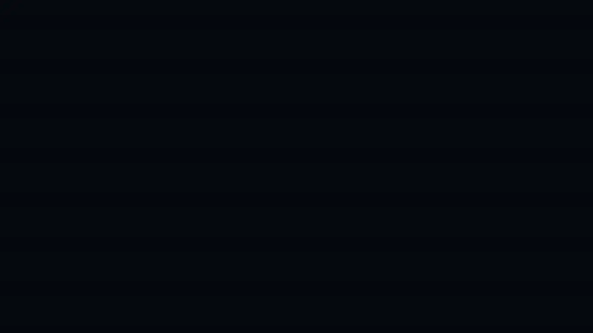
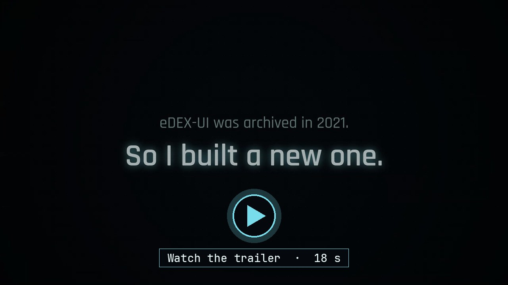
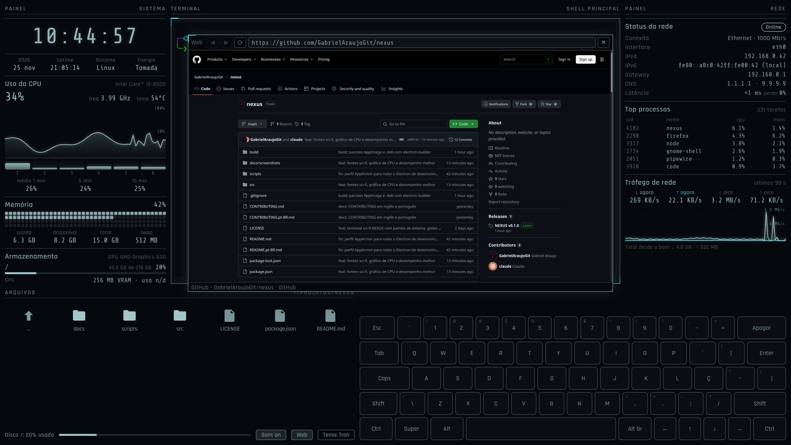
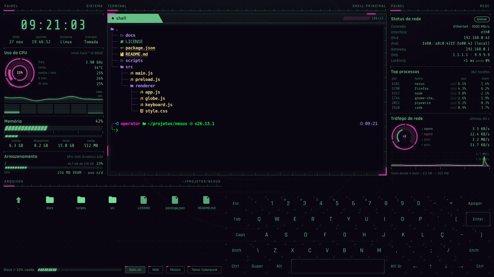

<div align="center">


# NEXUS

### Your shell, inside a sci-fi command center.

A Linux terminal wrapped in live panels for CPU, memory, network and files, plus a mini browser and YouTube Music.<br>
Inspired by movie interfaces and [eDEX-UI](https://github.com/GitSquared/edex-ui), rebuilt from scratch with
security and performance in mind.


**English · [Português (Brasil)](README.pt-BR.md)**

[Download](https://github.com/gabterm/nexus/releases/latest) ·
[Features](#features) ·
[Visual tour](#visual-tour) ·
[Install](#install) ·
[Security](#security-and-privacy) ·
[Wiki](https://github.com/gabterm/nexus/wiki) ·
[Roadmap](#roadmap)

</div>

<p align="center">
  
</p>

<p align="center">
  <a href="https://github.com/gabterm/nexus/blob/main/docs/promo-en.mp4"></a><br>
  <sub><b>Trailer</b> (18 s) · <a href="https://github.com/gabterm/nexus/blob/main/docs/promo-en.mp4">watch</a> · <a href="https://github.com/gabterm/nexus/raw/main/docs/promo-en.mp4">download MP4</a></sub>
</p>

## Why NEXUS

- **It's your real terminal.** Your `$SHELL` with your prompt, aliases, `tmux` and `vim`. The panels sit around it,
  they don't replace it.
- **eDEX-UI, rebuilt for today.** eDEX made sci-fi terminals famous but was archived in 2021. NEXUS starts fresh on
  current Electron, with a sandboxed UI and no telemetry.
- **Useful, not just pretty.** Per-core CPU, 1/5/15-minute averages, memory, disks, GPU, full network details,
  latency and packet loss, all live and color-coded when something goes wrong.
- **Light on your machine.** The globe renders in batches at 20 fps, slow metrics are cached, and nothing is
  collected while the window is minimized.

## Features

**Terminal**
- Your shell through `node-pty` + [xterm.js](https://xtermjs.org/): WebGL, 24-bit color, Nerd Fonts.
- On-screen keyboard (Brazilian ABNT2) that lights up as you type and also types on click.
- Files panel that follows your `cd`: click a folder to enter it, click a file to open it in the built-in viewer
  (text with line numbers, images, PDFs, and a hex view for binaries), or Shift+click to paste its name.

**System panels**
- **CPU**: animated core gauge (load, with a warning arc when it runs hot), 60 s area chart, segmented per-core bars, 1/5/15 min averages, frequency and temperature
  (yellow at 70 °C, red at 85 °C).
- **Memory**: usage %, used, available, total and swap.
- **Storage and GPU**: every real disk with used/total; GPU model and VRAM (usage and temperature on drivers that
  expose them without root, such as NVIDIA).
- **Processes**: top 6 by CPU and the task count.

**Network**
- Connection (Ethernet speed or Wi-Fi name), interface, full IPv4 and IPv6, gateway and DNS.
- Latency and packet loss to your gateway (local network only).
- 90 s download/upload chart with peaks and totals.

**Mini browser**
- A floating window (**Web** button) you can drag and resize, with address/search bar, back, forward and reload.
- Runs isolated: sandboxed, no access to the app, in-memory session, permissions and downloads denied.
- Built-in ad and tracker blocker (**AdBlock** button, on by default) with a per-page counter. It cuts requests to
  known ad networks and trackers and hides the usual ad slots; no extension or filter list download.

**Music**
- The **Música** button opens the official [YouTube Music](https://music.youtube.com) site in its own floating
  window. Hide it and the music keeps playing.
- A mini player in the files panel shows cover, track, artist and progress, with previous, play/pause and next.
- No API key and no unofficial API: the mini player reads what the site publishes about the current track and
  presses the site's own buttons. Your login is kept in a separate session only this window uses.
- The mini player has a clickable timeline (click, drag or arrow keys) to jump through the track.
- The **AdBlock** button also covers this window: ad and tracker requests are cut, and audio/video ads are
  muted and skipped as soon as the player starts one.

**Look and feel**
- HUD-style layout: thin rules instead of boxes, a dot-grid backdrop, an angled terminal tab and floating keys.
- 3 themes with muted, monitor-like palettes: **Tron**, **Cyberpunk** and **Amber**.
- An opening sequence: the screen switches on like a CRT, the icon draws itself and the name decodes (any key skips it).
- Synthesized UI sounds (no audio files), boot scan, theme glitch, CRT-style windows; all respect *reduce motion*,
  and the **Som** button mutes them.
- Alerts: panels turn red and a toast appears when CPU, temperature or memory hit the limit, or when the network
  drops.

> The interface text is in Brazilian Portuguese for now. An English UI is on the [roadmap](#roadmap).

## Visual tour

<table>
  <tr>
    <td colspan="2" align="center">
      <br>
      <sub><b>The opening</b>: CRT switch-on, the icon draws itself, the name decodes and the boot log fills the bar</sub>
    </td>
  </tr>
  <tr>
    <td width="50%" align="center" valign="top">
      <br>
      <sub><b>System</b>: CPU core gauge, history, segmented per-core bars, 1/5/15 min averages, memory and swap bands, disks and GPU</sub>
    </td>
    <td width="50%" align="center" valign="top">
      <br>
      <sub><b>Network</b>: full addresses, DNS, latency and packet loss, top processes and a traffic gauge (download outside, upload inside, latency in the middle)</sub>
    </td>
  </tr>
  <tr>
    <td colspan="2" align="center">
      <br>
      <sub><b>On-screen keyboard</b>: floating keys that light up as you type and type on click</sub>
    </td>
  </tr>
  <tr>
    <td colspan="2" align="center">
      <br>
      <sub><b>Tron · Cyberpunk · Amber</b>: muted, monitor-like palettes; strong color only for details and alerts</sub>
    </td>
  </tr>
</table>

### Full screens

<table>
  <tr>
    <td></td>
    <td></td>
  </tr>
  <tr>
    <td align="center"><b>Tron</b></td>
    <td align="center"><b>Mini browser</b></td>
  </tr>
  <tr>
    <td></td>
    <td></td>
  </tr>
  <tr>
    <td align="center"><b>Cyberpunk</b></td>
    <td align="center"><b>Amber</b></td>
  </tr>
</table>

## Install

### Download (Linux x86_64)

Get the latest `.deb` or AppImage from [Releases](https://github.com/gabterm/nexus/releases/latest):

```bash
# Debian/Ubuntu: installs the "nexus" command and a menu entry
sudo apt install ./nexus-*-amd64.deb

# Any distro: AppImage (needs FUSE 2; on Ubuntu: sudo apt install libfuse2t64)
chmod +x nexus-*-x86_64.AppImage && ./nexus-*-x86_64.AppImage
```

Verify downloads with `sha256sum -c SHA256SUMS`. On **Ubuntu 24.04+** prefer the `.deb`: it installs the
AppArmor profile Chromium's sandbox needs, while the AppImage may be blocked by that restriction.

For prompt icons, install a [Nerd Font](https://www.nerdfonts.com/) (NEXUS looks for `MesloLGS NF`, then
`JetBrains Mono`).

### From source

Requirements: Linux, Node.js 20+ and a C/C++ compiler for `node-pty`.

```bash
sudo apt install -y build-essential          # Debian/Ubuntu
git clone https://github.com/gabterm/nexus.git && cd nexus
npm install
npm run setup-pty                            # builds node-pty for Electron
npm start
```

<details>
<summary><b>Ubuntu 24.04+: <code>npm start</code> aborts with "The SUID sandbox helper binary…"</b></summary>

Ubuntu restricts the user namespaces Chromium's sandbox needs. Instead of turning the sandbox off, allow it
only for this project's Electron with an AppArmor profile:

```bash
sudo bash scripts/apparmor-dev.sh            # undo: sudo bash scripts/apparmor-dev.sh remove
```
</details>

| Command | What it does |
|---|---|
| `npm start` | Runs NEXUS |
| `npm run dist` | Builds the AppImage and `.deb` into `dist/` |
| `npm run screenshots` | Regenerates the README screenshots (demo mode) |
| `npm run demo` | Records the animated demo (`docs/demo.webp` and `docs/demo.gif`) |

## Shortcuts

| Key | Action |
|---|---|
| `F11` | Fullscreen |
| `Ctrl+Shift+C` / `Ctrl+Shift+V` | Copy / paste |
| `Ctrl+Shift+F12` | DevTools |
| `exit` or `Alt+F4` | Quit |

## Security and privacy

- The UI runs with `sandbox` and `contextIsolation`, without `nodeIntegration`, and talks to the main process only
  through a minimal IPC bridge (`src/preload.js`). A strict CSP blocks external scripts and connections.
- **No internet calls on its own.** Ping and packet loss only go to your local gateway, fonts are bundled, and the
  globe geolocates nothing. The network is only used when you open a page in the mini browser or the music window.
- The mini browser is a separate, sandboxed view: no Node, no access to the app's bridge, in-memory session
  (cookies are gone when you quit), permissions and downloads denied, http/https only.
- The music window is another sandboxed view with its own saved session (so you stay signed in), separate from the
  mini browser and the app. It only navigates to YouTube and Google sign-in, and **Sair da conta** erases that
  session.
- Screenshots and the demo run in **demo mode** with fake user, host, network, processes, memory and files, in a
  temporary profile, so nothing of yours ends up in an image.

## How it works

```
src/
├── main.js          window, shell (node-pty), metrics (systeminformation), capture modes
├── web.js           mini browser (isolated WebContentsView)
├── viewer.js        reads a file of the current folder for the viewer
├── pdfview.js       PDF in the viewer (Chromium's built-in reader, isolated view)
├── adblock.js       ad and tracker blocker for the mini browser
├── music.js         YouTube Music view and now-playing reader
├── preload.js       IPC bridge exposed as window.nexus
└── renderer/
    ├── index.html   panel layout
    ├── style.css    design tokens, themes and grid
    ├── app.js       wires terminal, panels, alerts and toasts
    ├── graphs.js    canvas charts
    ├── globe.js     wireframe globe (batched rendering)
    ├── keyboard.js  on-screen ABNT2 keyboard
    ├── sound.js     synthesized UI sounds (Web Audio)
    ├── floatwin.js  floating window frame (drag, CRT open/close, stacking)
    ├── web.js       mini browser window
    ├── viewer.js    file viewer window
    └── music.js     music window and mini player
```

## Roadmap

- [x] Live system and network panels, alerts and toasts
- [x] Themes, sounds and animations
- [x] `.deb` and AppImage packages
- [x] YouTube Music window with a mini player
- [ ] File explorer: path bar, search, list view, sorting, hidden files, right-click menu
- [ ] Customization: theme picker, more themes, color intensity, panel transparency
- [ ] English interface and more keyboard layouts (US, ISO)
- [ ] Terminal tabs and splits
- [ ] Process manager, sensors panel, notification center

## Contributing

Contributions are welcome! See [CONTRIBUTING.md](CONTRIBUTING.md), and the [wiki](https://github.com/gabterm/nexus/wiki) for detailed guides (usage, troubleshooting, architecture). If you like NEXUS, a ⭐ helps other people
find it.

## Credits

- Inspired by [eDEX-UI](https://github.com/GitSquared/edex-ui) by Gabriel Saillard (GPL-3.0); no code was reused.
- Built with [Electron](https://www.electronjs.org/), [xterm.js](https://xtermjs.org/),
  [node-pty](https://github.com/microsoft/node-pty) and
  [systeminformation](https://systeminformation.io/).
- Fonts [Rajdhani](https://fonts.google.com/specimen/Rajdhani) and
  [Share Tech Mono](https://fonts.google.com/specimen/Share+Tech+Mono) via
  [Fontsource](https://fontsource.org/), under the SIL Open Font License 1.1.

## License

[MIT](LICENSE)
