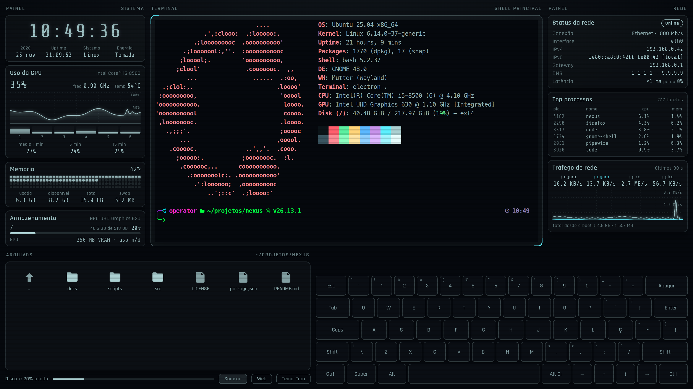
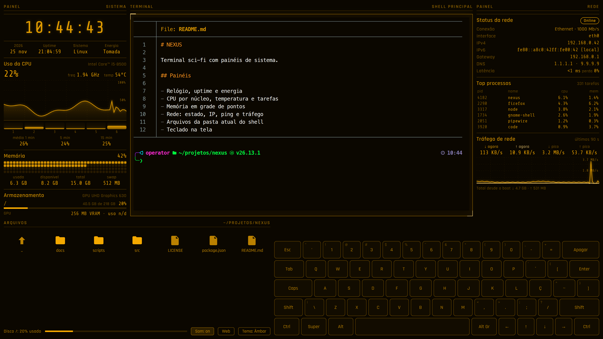

<div align="center">

# NEXUS

**A sci-fi terminal for Linux, with live system panels around your shell.**

Inspired by movie interfaces and by [eDEX-UI](https://github.com/GitSquared/edex-ui) (archived in 2021),
rewritten from scratch with current dependencies and a focus on security.


**English · [Português (Brasil)](README.pt-BR.md)**

</div>



<table>
  <tr>
    <td></td>
    <td></td>
  </tr>
  <tr>
    <td align="center"><b>Cyberpunk</b></td>
    <td align="center"><b>Amber</b></td>
  </tr>
</table>

## Features

- **A real terminal**: your shell (`$SHELL`) through `node-pty` + [xterm.js](https://xtermjs.org/), with WebGL,
  24-bit color and Nerd Fonts. Your prompt (Starship, Oh My Bash, etc.) works as usual.
- **System**: clock, uptime, power, CPU per core group, temperature, load, tasks,
  a dot-grid memory map and swap.
- **Processes**: the top 6 by CPU, refreshed every 3 s.
- **Network**: status, IPv4, gateway ping, download/upload traffic and totals.
- **Globe**: a spinning wireframe with nodes and links (decorative).
- **Files**: shows the shell's current folder (follows `cd` on its own). Click a folder to enter it;
  click a file to paste its name into the prompt.
- **On-screen keyboard (Brazilian ABNT2)**: lights up as you type and also types on click.
- **Mini browser**: the **WEB** button opens a floating window (drag it by the bar, resize it from the corner)
  with an address/search bar (DuckDuckGo), back, forward and reload. http/https only.
- **3 themes**: Tron, Cyberpunk and Amber, switched with the **TEMA** button.

> The interface text is in Brazilian Portuguese for now.

## Install

### Download (x86_64)

Grab the latest version from [Releases](https://github.com/GabrielAraujoGit/nexus/releases/latest):

```bash
# Debian/Ubuntu: installs the "nexus" command and a menu entry
sudo apt install ./nexus-0.1.0-amd64.deb

# Any distro: AppImage (needs FUSE 2; on Ubuntu: sudo apt install libfuse2t64)
chmod +x nexus-0.1.0-x86_64.AppImage
./nexus-0.1.0-x86_64.AppImage
```

Checksums are in `SHA256SUMS` (`sha256sum -c SHA256SUMS`).

### From source

Requirements: Linux, Node.js 20+ and a C/C++ compiler for `node-pty`.

```bash
# Ubuntu/Debian
sudo apt install -y build-essential

git clone https://github.com/GabrielAraujoGit/nexus.git
cd nexus
npm install
npm run setup-pty    # builds node-pty for Electron
npm start

npm run dist          # optional: builds the AppImage and .deb into dist/
```

To see prompt icons, install a [Nerd Font](https://www.nerdfonts.com/)
(NEXUS looks for `MesloLGS NF`, then `JetBrains Mono`).

## Shortcuts

| Key | Action |
|---|---|
| `F11` | Fullscreen |
| `Ctrl+Shift+C` / `Ctrl+Shift+V` | Copy / paste |
| `Ctrl+Shift+F12` | DevTools |
| `exit` or `Alt+F4` | Quit |

## Security and privacy

- The UI runs with `sandbox` and `contextIsolation`, without `nodeIntegration`, and only talks to the main
  process through a minimal IPC bridge (`src/preload.js`).
- The CSP blocks external scripts and connections, and the window never navigates away from the app.
- **No internet calls on its own**: the ping only goes to your local network gateway and the globe doesn't
  geolocate anything. The network is only used when you open a page in the mini browser.
- The mini browser is a separate view: sandboxed, with no access to Node or to the app's bridge, an in-memory
  session (cookies are gone when you quit), permissions (camera, microphone, location, notifications) and
  downloads denied, and http/https only.

## How it works

```
src/
├── main.js          window, shell (node-pty), metrics (systeminformation),
│                    shell's current folder via /proc/<pid>/cwd
├── web.js           mini browser (isolated WebContentsView)
├── preload.js       IPC bridge exposed as window.nexus
└── renderer/
    ├── index.html   panel layout
    ├── style.css    themes (CSS variables) and grid
    ├── app.js       wires terminal, panels and data
    ├── graphs.js    canvas line charts
    ├── globe.js     wireframe globe
    ├── keyboard.js  on-screen ABNT2 keyboard
    └── web.js       mini browser floating window
```

## Screenshots

The images above are generated by `npm run screenshots`, which runs the app in **demo mode**:
user, host, IP, processes and home folder are fake, so you can regenerate them without exposing anything of yours.

## Roadmap

- [ ] Terminal tabs and splits
- [ ] File-based custom themes
- [ ] More keyboard layouts (US, ISO)
- [ ] UI sounds (optional)
- [ ] Git panel (branch and changes in the current folder)
- [ ] English interface
- [x] `.deb` and AppImage packages

## Contributing

Contributions are welcome! See [CONTRIBUTING.md](CONTRIBUTING.md).

## License

[MIT](LICENSE)
