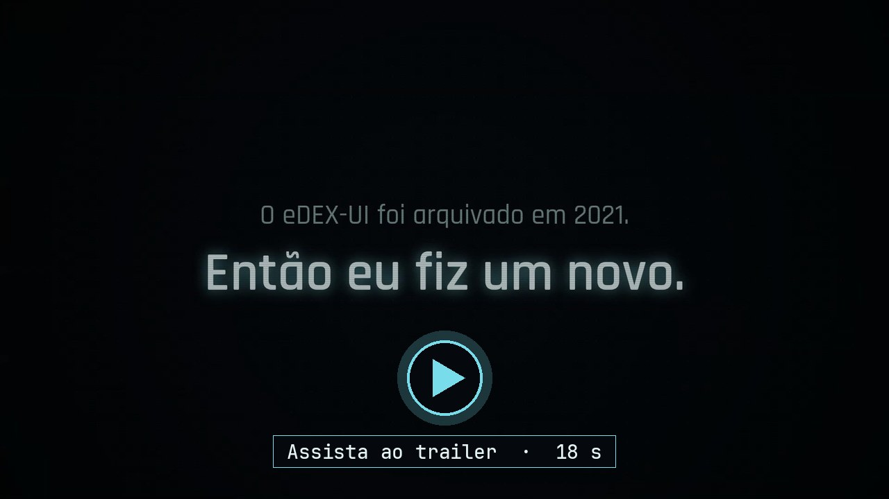
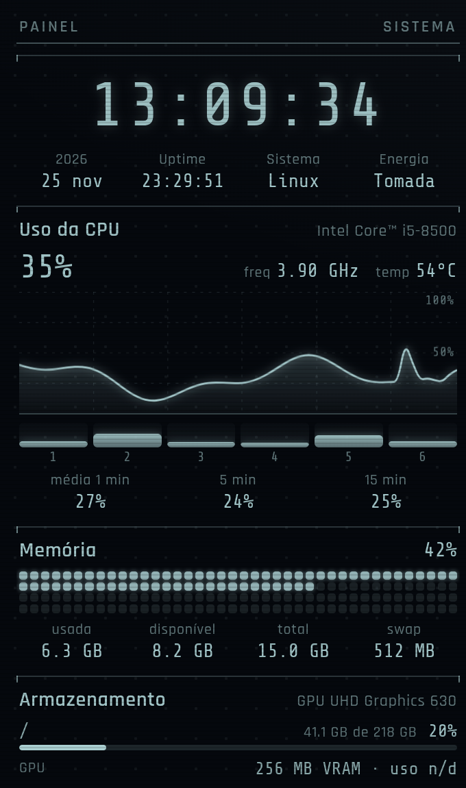
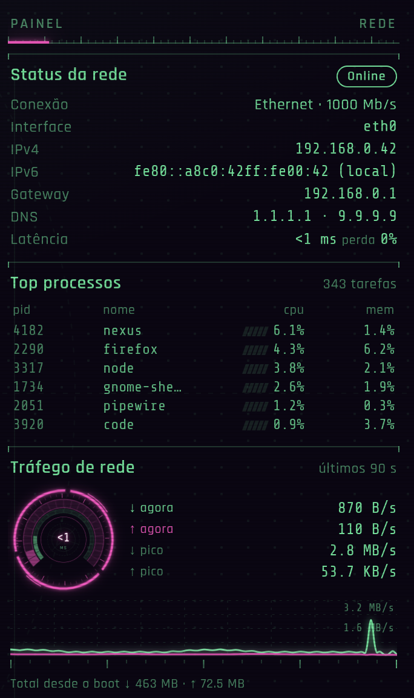
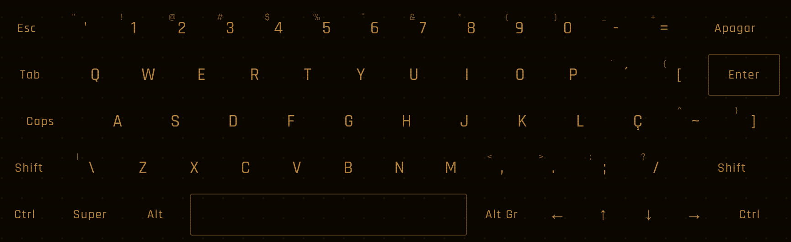
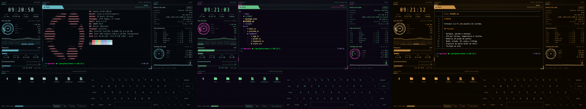

<div align="center">


# NEXUS

### Seu shell dentro de uma central de comando sci-fi.

Um terminal para Linux cercado de painéis ao vivo de CPU, memória, rede e arquivos, com mini navegador e YouTube Music.<br>
Inspirado em interfaces de filme e no [eDEX-UI](https://github.com/GitSquared/edex-ui), reescrito do zero com foco
em segurança e desempenho.


**[English](README.md) · Português (Brasil)**

[Baixar](https://github.com/gabterm/nexus/releases/latest) ·
[Recursos](#recursos) ·
[Tour visual](#tour-visual) ·
[Instalar](#instalar) ·
[Segurança](#segurança-e-privacidade) ·
[Wiki](https://github.com/gabterm/nexus/wiki/In%C3%ADcio) ·
[Próximos passos](#próximos-passos)

</div>

<p align="center">
  
</p>

<p align="center">
  <a href="https://github.com/gabterm/nexus/blob/main/docs/promo-pt.mp4"></a><br>
  <sub><b>Trailer</b> (18 s) · <a href="https://github.com/gabterm/nexus/blob/main/docs/promo-pt.mp4">assistir</a> · <a href="https://github.com/gabterm/nexus/raw/main/docs/promo-pt.mp4">baixar MP4</a></sub>
</p>

## Por que o NEXUS

- **É o seu terminal de verdade.** Seu `$SHELL` com prompt, aliases, `tmux` e `vim`. Os painéis ficam em volta,
  não no lugar.
- **O eDEX-UI refeito para hoje.** O eDEX popularizou os terminais sci-fi, mas foi arquivado em 2021. O NEXUS começa
  do zero, com Electron atual, interface em sandbox e sem telemetria.
- **Útil, não só bonito.** CPU por núcleo, médias de 1/5/15 min, memória, discos, GPU, rede completa, latência e
  perda de pacotes, tudo ao vivo e com cor quando algo sai do normal.
- **Leve na sua máquina.** O globo desenha em lote a 20 fps, métricas lentas ficam em cache e nada é coletado com a
  janela minimizada.

## Recursos

**Terminal**
- Seu shell via `node-pty` + [xterm.js](https://xtermjs.org/): WebGL, cores 24 bits, Nerd Fonts.
- Teclado na tela (ABNT2) que acende enquanto você digita e também digita no clique.
- Painel de arquivos que segue o seu `cd`: clique numa pasta para entrar, num arquivo para colar o nome.

**Painéis de sistema**
- **CPU**: núcleo animado (carga, com arco de aviso quando esquenta), gráfico de área de 60 s, blocos por núcleo, médias de 1/5/15 min, frequência e temperatura
  (amarelo a 70 °C, vermelho a 85 °C).
- **Memória**: % de uso, usada, disponível, total e swap.
- **Armazenamento e GPU**: cada disco real com usado/total; modelo e VRAM da GPU (uso e temperatura nos drivers que
  informam isso sem root, como NVIDIA).
- **Processos**: os 6 que mais usam CPU e o total de tarefas.

**Rede**
- Conexão (velocidade da Ethernet ou nome do Wi-Fi), interface, IPv4 e IPv6 completos, gateway e DNS.
- Latência e perda de pacotes até o gateway (só a rede local).
- Gráfico de 90 s de download/upload com picos e totais.

**Mini navegador**
- Janela flutuante (botão **Web**) que dá para arrastar e redimensionar, com endereço/busca, voltar, avançar e
  recarregar.
- Roda isolado: sandbox, sem acesso ao app, sessão só em memória, permissões e downloads negados.
- Bloqueador de anúncios e rastreadores embutido (botão **AdBlock**, ligado por padrão) com contador por página.
  Corta as requisições para redes de anúncio e rastreadores conhecidos e esconde os espaços de anúncio comuns;
  sem extensão nem download de lista de filtros.

**Música**
- O botão **Música** abre o site oficial do [YouTube Music](https://music.youtube.com) numa janela flutuante própria.
  Esconda a janela e a música continua.
- Um mini player no painel de arquivos mostra capa, faixa, artista e progresso, com anterior, tocar/pausar e próxima.
- Sem chave de API e sem API não oficial: o mini player lê o que o site publica sobre a faixa atual e aperta os
  botões do próprio site. O login fica numa sessão separada, usada só por essa janela.

**Visual**
- Visual de HUD: linhas finas no lugar de caixas, fundo com grade de pontos, aba angulada no terminal e teclas flutuantes.
- 3 temas com paletas suaves, de monitor: **Tron**, **Cyberpunk** e **Âmbar**.
- Abertura: a tela liga como um monitor CRT, o ícone se desenha e o nome é decodificado (qualquer tecla pula).
- Sons sintetizados (sem arquivos de áudio), varredura no boot, falha de sinal ao trocar de tema e janelas estilo CRT;
  tudo respeita *reduzir movimento* e o botão **Som** desliga.
- Alertas: o painel fica vermelho e aparece um aviso quando CPU, temperatura ou memória chegam ao limite, ou quando a
  rede cai.

## Tour visual

<table>
  <tr>
    <td colspan="2" align="center">
      <br>
      <sub><b>A abertura</b>: a tela liga como um CRT, o ícone se desenha, o nome é decodificado e o log enche a barra</sub>
    </td>
  </tr>
  <tr>
    <td width="50%" align="center" valign="top">
      <br>
      <sub><b>Sistema</b>: núcleo da CPU, histórico, blocos por núcleo, médias de 1/5/15 min, faixas de memória e swap, discos e GPU</sub>
    </td>
    <td width="50%" align="center" valign="top">
      <br>
      <sub><b>Rede</b>: endereços completos, DNS, latência e perda de pacotes, processos e um núcleo de tráfego (download por fora, upload por dentro, latência no centro)</sub>
    </td>
  </tr>
  <tr>
    <td colspan="2" align="center">
      <br>
      <sub><b>Teclado na tela</b>: teclas flutuantes que acendem enquanto você digita e digitam no clique</sub>
    </td>
  </tr>
  <tr>
    <td colspan="2" align="center">
      <br>
      <sub><b>Tron · Cyberpunk · Âmbar</b>: paletas suaves, de monitor; cor forte só em detalhes e alertas</sub>
    </td>
  </tr>
</table>

### Telas completas

<table>
  <tr>
    <td></td>
    <td></td>
  </tr>
  <tr>
    <td align="center"><b>Tron</b></td>
    <td align="center"><b>Mini navegador</b></td>
  </tr>
  <tr>
    <td></td>
    <td></td>
  </tr>
  <tr>
    <td align="center"><b>Cyberpunk</b></td>
    <td align="center"><b>Âmbar</b></td>
  </tr>
</table>

## Instalar

### Baixar (Linux x86_64)

Pegue o `.deb` ou o AppImage mais recente em [Releases](https://github.com/gabterm/nexus/releases/latest):

```bash
# Debian/Ubuntu: instala o comando "nexus" e o atalho no menu
sudo apt install ./nexus-*-amd64.deb

# Qualquer distro: AppImage (precisa do FUSE 2; no Ubuntu: sudo apt install libfuse2t64)
chmod +x nexus-*-x86_64.AppImage && ./nexus-*-x86_64.AppImage
```

Confira os arquivos com `sha256sum -c SHA256SUMS`. No **Ubuntu 24.04+** prefira o `.deb`: ele instala o perfil
AppArmor que o sandbox do Chromium precisa, enquanto o AppImage pode ser bloqueado por essa restrição.

Para os ícones do prompt, instale uma [Nerd Font](https://www.nerdfonts.com/) (o NEXUS procura `MesloLGS NF` e
depois `JetBrains Mono`).

### Pelo código-fonte

Pré-requisitos: Linux, Node.js 20+ e um compilador C/C++ para o `node-pty`.

```bash
sudo apt install -y build-essential          # Debian/Ubuntu
git clone https://github.com/gabterm/nexus.git && cd nexus
npm install
npm run setup-pty                            # compila o node-pty para o Electron
npm start
```

<details>
<summary><b>Ubuntu 24.04+: o <code>npm start</code> aborta com "The SUID sandbox helper binary…"</b></summary>

O Ubuntu restringe os user namespaces que o sandbox do Chromium usa. Em vez de desligar o sandbox, libere só o
Electron deste projeto com um perfil AppArmor:

```bash
sudo bash scripts/apparmor-dev.sh            # para desfazer: sudo bash scripts/apparmor-dev.sh remove
```
</details>

| Comando | O que faz |
|---|---|
| `npm start` | Abre o NEXUS |
| `npm run dist` | Gera o AppImage e o `.deb` em `dist/` |
| `npm run screenshots` | Regera as capturas do README (modo demo) |
| `npm run demo` | Grava a demo animada (`docs/demo.webp` e `docs/demo.gif`) |

## Atalhos

| Tecla | Ação |
|---|---|
| `F11` | Tela cheia |
| `Ctrl+Shift+C` / `Ctrl+Shift+V` | Copiar / colar |
| `Ctrl+Shift+F12` | DevTools |
| `exit` ou `Alt+F4` | Fechar |

## Segurança e privacidade

- A interface roda com `sandbox` e `contextIsolation`, sem `nodeIntegration`, e só fala com o processo principal por
  uma ponte IPC mínima (`src/preload.js`). Uma CSP rígida bloqueia scripts e conexões externas.
- **Nenhuma chamada para a internet por conta própria.** Ping e perda de pacotes vão só até o gateway local, as fontes
  vêm embutidas e o globo não geolocaliza nada. A rede só é usada quando você abre uma página no mini navegador ou
  a janela de música.
- O mini navegador é uma view separada e em sandbox: sem Node, sem acesso à ponte do app, sessão só em memória
  (cookies somem ao fechar), permissões e downloads negados, só http/https.
- A janela de música é outra view em sandbox, com sessão salva própria (para você continuar logado), separada do mini
  navegador e do app. Só navega no YouTube e no login do Google, e **Sair da conta** apaga essa sessão.
- Capturas e a demo rodam em **modo demo**, com usuário, máquina, rede, processos, memória e arquivos fictícios, num
  perfil temporário: nada seu vai parar numa imagem.

## Como funciona

```
src/
├── main.js          janela, shell (node-pty), métricas (systeminformation), modos de captura
├── web.js           mini navegador (WebContentsView isolada)
├── adblock.js       bloqueador de anúncios e rastreadores do mini navegador
├── music.js         view do YouTube Music e leitura da faixa atual
├── preload.js       ponte IPC exposta como window.nexus
└── renderer/
    ├── index.html   layout dos painéis
    ├── style.css    tokens de design, temas e grade
    ├── app.js       liga terminal, painéis, alertas e avisos
    ├── graphs.js    gráficos em canvas
    ├── globe.js     globo wireframe (desenho em lote)
    ├── keyboard.js  teclado ABNT2 na tela
    ├── sound.js     sons de interface sintetizados (Web Audio)
    ├── floatwin.js  moldura das janelas flutuantes (arrastar, abrir/fechar como CRT, ordem)
    ├── web.js       janela do mini navegador
    └── music.js     janela de música e mini player
```

## Próximos passos

- [x] Painéis de sistema e rede ao vivo, alertas e avisos
- [x] Temas, sons e animações
- [x] Pacotes `.deb` e AppImage
- [x] Janela do YouTube Music com mini player
- [ ] Explorador de arquivos: barra de caminho, busca, lista, ordenação, ocultos, menu de contexto
- [ ] Personalização: seletor de temas, mais temas, intensidade das cores, transparência dos painéis
- [ ] Interface em inglês e outros layouts de teclado (US, ISO)
- [ ] Abas e divisão do terminal
- [ ] Gerenciador de processos, painel de sensores, central de notificações

## Contribuir

Contribuições são bem-vindas! Veja o [CONTRIBUTING.pt-BR.md](CONTRIBUTING.pt-BR.md) e a [wiki](https://github.com/gabterm/nexus/wiki/In%C3%ADcio), com guias detalhados (uso, solução de problemas, arquitetura). Se você curtiu o NEXUS, uma ⭐
ajuda outras pessoas a encontrarem o projeto.

## Créditos

- Inspirado no [eDEX-UI](https://github.com/GitSquared/edex-ui), de Gabriel Saillard (GPL-3.0); nenhum código foi
  reaproveitado.
- Feito com [Electron](https://www.electronjs.org/), [xterm.js](https://xtermjs.org/),
  [node-pty](https://github.com/microsoft/node-pty) e [systeminformation](https://systeminformation.io/).
- Fontes [Rajdhani](https://fonts.google.com/specimen/Rajdhani) e
  [Share Tech Mono](https://fonts.google.com/specimen/Share+Tech+Mono) via [Fontsource](https://fontsource.org/),
  sob a SIL Open Font License 1.1.

## Licença

[MIT](LICENSE)
