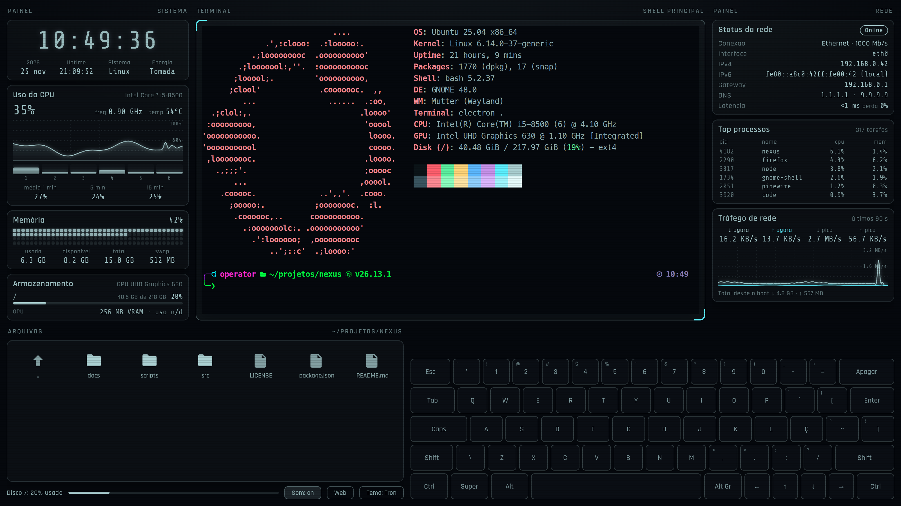
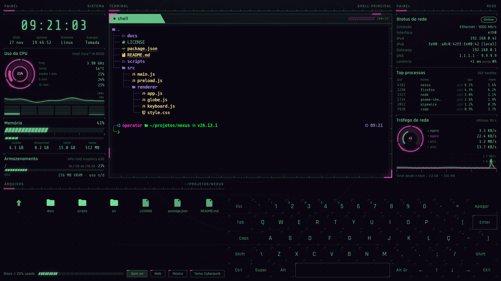
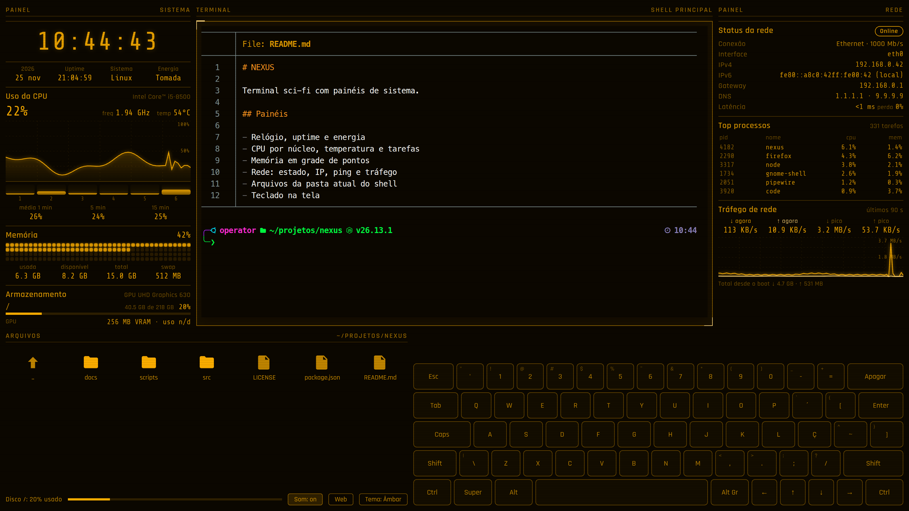

<div align="center">

# NEXUS

**Um terminal sci-fi para Linux, com painéis de sistema ao vivo em volta do seu shell.**

Inspirado no visual de filmes e no [eDEX-UI](https://github.com/GitSquared/edex-ui) (arquivado em 2021),
reescrito do zero com dependências atuais e foco em segurança.


**[English](README.md) · Português (Brasil)**

</div>



<table>
  <tr>
    <td></td>
    <td></td>
  </tr>
  <tr>
    <td align="center"><b>Cyberpunk</b></td>
    <td align="center"><b>Âmbar</b></td>
  </tr>
</table>

## O que tem

- **Terminal de verdade**: seu shell (`$SHELL`) via `node-pty` + [xterm.js](https://xtermjs.org/), com WebGL,
  cores 24 bits e Nerd Fonts. Seu prompt (Starship, Oh My Bash etc.) funciona igual.
- **Sistema**: relógio, uptime, energia, CPU por grupo de núcleos, temperatura, carga, tarefas,
  memória em grade de pontos e swap.
- **Processos**: os 6 que mais usam CPU, atualizados a cada 3 s.
- **Rede**: estado, IPv4, ping do gateway, tráfego de download/upload e totais.
- **Globo**: wireframe girando com nós e conexões (decorativo).
- **Arquivos**: mostra a pasta onde o shell está (segue o `cd` sozinho). Clique numa pasta para entrar;
  num arquivo, o nome é colado no prompt.
- **Teclado na tela (ABNT2)**: acende com o teclado físico e também digita no clique.
- **Mini navegador**: botão **WEB** abre uma janela flutuante (arraste pela barra, redimensione pelo canto)
  com endereço ou busca (DuckDuckGo), voltar, avançar e recarregar. Só http/https.
- **3 temas**: Tron, Cyberpunk e Âmbar, trocados pelo botão **TEMA**.

## Instalar

Pré-requisitos: Linux, Node.js 20+ e um compilador C/C++ para o `node-pty`.

```bash
# Ubuntu/Debian
sudo apt install -y build-essential

git clone https://github.com/GabrielAraujoGit/nexus.git
cd nexus
npm install
npm run setup-pty    # compila o node-pty para o Electron
npm start
```

Para ver os ícones do prompt, instale uma [Nerd Font](https://www.nerdfonts.com/)
(o NEXUS procura `MesloLGS NF` e depois `JetBrains Mono`).

## Atalhos

| Tecla | Ação |
|---|---|
| `F11` | Tela cheia |
| `Ctrl+Shift+C` / `Ctrl+Shift+V` | Copiar / colar |
| `Ctrl+Shift+F12` | DevTools |
| `exit` ou `Alt+F4` | Fechar |

## Segurança e privacidade

- A interface roda com `sandbox`, `contextIsolation` e sem `nodeIntegration`; só fala com o processo
  principal por uma ponte IPC mínima (`src/preload.js`).
- A CSP bloqueia scripts e conexões externas, e a janela não navega para fora do app.
- **Nenhuma chamada para a internet por conta própria**: o ping vai só até o gateway da rede local e o globo não
  geolocaliza nada. A rede só é usada quando você abre uma página no mini navegador.
- O mini navegador é uma view separada: sandbox, sem acesso ao Node nem à ponte do app, sessão só em memória
  (cookies somem ao fechar), permissões (câmera, microfone, localização, notificações) e downloads negados,
  e só aceita http/https.

## Como funciona

```
src/
├── main.js          janela, shell (node-pty), métricas (systeminformation),
│                    pasta atual do shell via /proc/<pid>/cwd
├── web.js           mini navegador (WebContentsView isolada)
├── preload.js       ponte IPC exposta como window.nexus
└── renderer/
    ├── index.html   layout dos painéis
    ├── style.css    temas (variáveis CSS) e grade
    ├── app.js       liga terminal, painéis e dados
    ├── graphs.js    gráficos de linha em canvas
    ├── globe.js     globo wireframe
    ├── keyboard.js  teclado ABNT2 na tela
    └── web.js       janela flutuante do mini navegador
```

## Capturas de tela

As imagens acima são geradas por `npm run screenshots`, que roda o app em **modo demo**:
usuário, máquina, IP, processos e pasta pessoal são fictícios, então dá para regerar sem expor nada seu.

## Próximos passos

- [ ] Abas e divisão do terminal
- [ ] Temas configuráveis por arquivo
- [ ] Outros layouts de teclado (US, ISO)
- [ ] Sons de interface (opcionais)
- [ ] Painel de git (branch e mudanças da pasta atual)
- [ ] Interface em inglês
- [ ] Pacotes `.deb` e AppImage

## Contribuir

Contribuições são bem-vindas! Veja o [CONTRIBUTING.md](CONTRIBUTING.md).

## Licença

[MIT](LICENSE)
